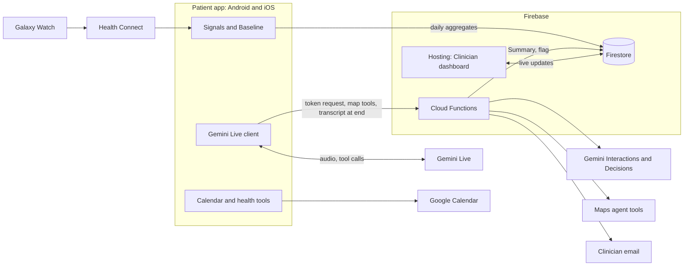
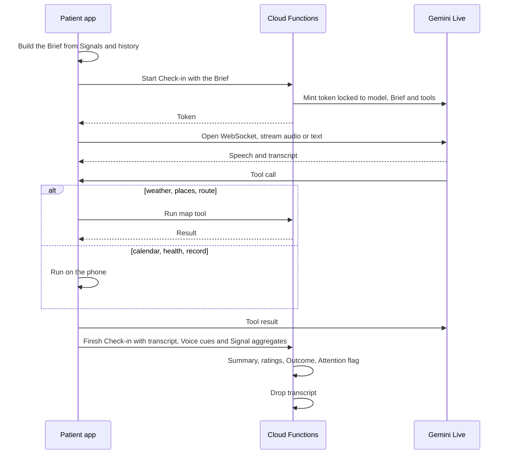

# System design

Written on 2026-11-13. This is the merged design: it combines six rounds of design questions with the Android and Firebase design proposed in [PR #2](https://github.com/hhoangphuoc/2am-depressify/pull/2), and replaces both.

Terms in capitals are defined in [GLOSSARY.md](../../GLOSSARY.md). Decisions that are costly to undo are in [docs/adr](../adr). API facts and their sources are in [docs/research](../research); the brief is in [ideas-junction.md](ideas-junction.md).

## Purpose and scope

The product supports a Patient in the time between Visits, after their TMS course has ended. It follows the loop the challenge asks for:

1. **Sense** how the Patient is doing, through Signals.
2. **Respond** in a short spoken Check-in with the Companion that ends in one concrete Suggestion.
3. **Learn** from the Outcome of each Suggestion which kinds help this Patient.

The Clinician follows progress Phase by Phase and is told who may need a call, without extra work.

- It is a wellbeing companion. The Companion never diagnoses or advises on treatment ([ADR 0001](../adr/0001-wellbeing-companion-not-clinical-treatment.md)).
- V1 is a hackathon demo: about 48 hours, two or three developers, shown on a Galaxy S24+ with a Galaxy Watch.
- V1 serves a Patient after TMS and their Clinician. "Anyone at risk of depression" is left out.
- The demo is in English.

## System overview

| Part | What it is |
|---|---|
| `core` | Pure Kotlin, no platform code: models, Baseline, Attention flag rules, Nudge rules, learning, Brief builder, tool dispatch. Unit tested on the JVM. |
| `shared` | Kotlin Multiplatform client code: Compose Multiplatform UI, Gemini Live client, Firebase access, and common interfaces for audio, health, calendar, location and notifications |
| `androidApp`, `iosApp` | Patient app entry points and platform implementations |
| `firebase/functions` | Cloud Functions in TypeScript |
| `firebase/hosting` | Clinician dashboard: plain HTML and JavaScript with Chart.js |
| `firebase/seed` | Script that creates the Demo Patients |

The backend is Firebase: Firestore, Auth, Cloud Functions, Cloud Messaging and Hosting, in the EU region `europe-north1` (Finland) ([ADR 0008](../adr/0008-firebase-backend-and-plain-web-dashboard.md)). Shared code reaches Firebase through the GitLive `firebase-kotlin-sdk`.

### What leaves the phone

Raw sensor samples, audio and transcripts are never stored outside the phone ([ADR 0006](../adr/0006-transcripts-are-deleted-after-the-summary.md)). Audio is streamed to Gemini Live during a Check-in. The transcript passes through one Cloud Function in memory when the Check-in ends and is then dropped. Firestore holds daily aggregates, Summaries, Suggestions and flags only.

## Roles and sign-in

- The Patient signs in anonymously for the demo. The Clinician signs in with email and password.
- The Invite that links a Patient to a Clinician is deferred. In the demo there is one Clinician, and a new Patient is linked to them when the app first opens.
- The Clinician adds the Intake on the dashboard. For the demo it is a fictional clinical report; Gemini extracts the highlights the Companion needs.
- The Clinician records each Visit, with an optional Questionnaire score (PHQ-2 or PHQ-9), and enters the TMS end date.

## Signals and Consent

| Signal | Source | Notes |
|---|---|---|
| Sleep, steps, heart rate, resting heart rate, HRV | Health Connect, fed by the watch through Samsung Health | The hour-0 spike checks whether Samsung writes HRV. If it does not, resting heart rate is used and HRV is seeded. |
| Late-night screen time | Android usage statistics | Needs a special permission; included only if the spike shows the data is usable |
| Time at home, movement radius | Periodic location samples | Computed on the phone; only the two aggregates are stored |
| Calendar load and free time | Google Calendar | Read on the phone |
| Weather | Maps agent tools | Fetched during a Check-in and for Nudges |
| Mood, energy and sleep quality ratings | Said by the Patient at a Check-in | 1 to 5 each |
| Voice cues | Noted by the Companion during a Check-in | See below |

- Each Signal is switched on separately and needs its own Consent. Switching one off stops collection and deletes what was collected. Calendar permission is requested from Google only when that Signal is switched on.
- Each Signal is compared with the Patient's own Baseline: the previous 14 days, needing at least 5 valid days. Patients are never compared with each other.
- A missing day is recorded as missing, never as zero. A night without the watch must not look like a night without sleep.
- Health Signals reach iOS through HealthKit only if time allows ([ADR 0003](../adr/0003-health-signals-read-on-device.md)).
- Music is not sensed.

### Voice cues

The Live model hears tone, sighs and hesitation. The Companion is told to note a Voice cue when it notices one (a label, an intensity from 1 to 5, and what it heard) and to adapt its replies. Voice cues appear in the Summary as observations.

Stretch goal: measure pitch variation, speech rate and pauses on the phone against the Patient's Baseline. If this slips it is dropped. Recorded audio is never sent out as a substitute.

## The Check-in

**Connection.** The phone connects straight to Gemini Live with a short-lived token ([ADR 0002](../adr/0002-phone-connects-directly-to-gemini-live.md)). The first choice is a raw Ktor WebSocket in shared Kotlin, so Android and iOS share one client. If the hour-0 spike fails, the fallback is the Firebase AI Logic SDK on each platform.

**The Brief.** Intake highlights, the latest Digest or recent Summaries, today's Signals against Baseline, the last Suggestion and its Outcome, the three kinds of Suggestion that have helped most, today's weather and today's calendar.

**Tone.** Calm and warm, short sentences, one question at a time, one fixed voice, no persona name. It must not nag a low-energy person.

**Shape.** Greet with something from the Brief, ask how the last Suggestion went, listen, offer one Suggestion and get a commitment, ask for the three ratings, close. The target is 3 minutes; the cap is about 8. The Patient can type when they cannot speak.

**Tools.**

| Tool | What it does | Runs in | Backed by |
|---|---|---|---|
| Read weather | Current weather, forecast and daylight | Cloud Function | Maps agent tools `lookupWeather` |
| Find places | Parks, classes and similar nearby | Cloud Function | Maps agent tools `searchText` |
| Get walking route | Distance and time on foot | Cloud Function | Maps agent tools `computeRoutes` |
| Read free time | Events and free slots for a day | Phone | Calendar `events.list`, `freeBusy` |
| Book calendar event | Books the Suggestion after the Patient agrees aloud | Phone | Calendar `events.insert` |
| Read health summary | Recent Signals against Baseline | Phone | `core` |
| Play music | Opens a music app with a genre or mood | Phone | Deep link |
| Note Voice cue | Records what the Companion heard | Phone | Kept for the Summary |
| Record Suggestion | Saves what was proposed | Phone | Firestore |
| Raise crisis | Shows the Crisis notice and sets the flag to red | Phone | See Crisis |

Suggestions appear as cards on the Check-in screen; a place card opens Google Maps. Outside a Check-in, the Today screen shows Suggestions from the `suggestToday` function with places on an embedded Google map (Android).

**Disclosure.** At a Patient's first Check-in the Companion says it is an AI and not a clinician. The Check-in screen always shows the live transcript and states that place results come from Google Maps, with links, as the Maps terms require.

**Failure.** If the connection drops, the app offers a retry and finishes the Check-in with whatever transcript it has. A silent or very short Check-in still produces a Summary.

**Not included.** Camera or facial capture, booking classes, session resumption.

## After a Check-in

One Cloud Function receives the transcript, the Voice cues and the day's Signal aggregates, and produces:

1. A Summary: mood, sleep, themes, Voice cues, the Suggestion made, the Outcome of the previous one, and a few short quotes that explain a flag. The Patient reads exactly the same Summary as the Clinician ([ADR 0005](../adr/0005-clinician-sees-summaries-not-conversations.md)).
2. The three ratings.
3. The Outcome of the previous Suggestion.
4. The Attention flag judgment.

The Summary and extraction use `gemini-4-hydrogen` with structured output. The judgment uses the Gemini Decisions API.

## Learning what helps

Each Suggestion has a kind (walk, class, music, calling someone, and so on). Its Outcome combines the Patient's answer at the next Check-in (whether they tried it, and how it felt from 1 to 5) with that day's change in steps against Baseline (time outside is not measured). The three best kinds go into the Brief. About one Suggestion in five deliberately tries something new. The dashboard shows "what works for this Patient".

## Attention flag

The flag is green, amber or red, always with written reasons and never a score ([ADR 0009](../adr/0009-attention-flag-has-three-levels-with-reasons.md)). The Clinician clears it after acting. The Patient never sees it.

The Decisions API answers three yes/no questions about each Check-in: is there a crisis, is there marked hopelessness or decline, and did the Patient try the last Suggestion.

| Level | Raised by | What happens |
|---|---|---|
| Amber | Decline or hopelessness in a Check-in; a Mood rating of 2 or lower in three Check-ins in a row; sleep well below Baseline for three nights; sustained drift across several Signals; the safety filter refusing to judge a Check-in | The Patient moves up the dashboard list with the reasons shown |
| Red | A crisis in a Check-in; no sign of life from the phone for 24 hours; a sharp break such as a sleep collapse, or a day with no steps and no screen use | As amber, plus a banner on the dashboard and an email to the Clinician |

A phone cannot report its own silence, so a Cloud Function checks each hour for Patients whose phone has been quiet for 24 hours. Thresholds are starting values to tune on the Demo Patients.

## Crisis

When the Companion hears signs of self-harm risk it raises a crisis. The Decisions API is the backstop if it does not.

- The Crisis notice appears at once, before any network call, with one-tap buttons to call for help. The buttons open the dialler; the Patient places the call. The app never dials.
- In the demo the buttons carry a mock number, not a real crisis line.
- The flag goes to red, so the Clinician gets the email and the dashboard banner. If the phone is offline the alert is queued.
- The Companion stays calm and present and does not counsel.
- Signals alone never show the Crisis notice. They only alert the Clinician.

## Nudges

The Companion cannot start talking on its own; a Nudge is a notification the Patient taps to start a Check-in. The phone decides, checking about every six hours.

Triggers: no Check-in yet by early evening; a free hour in the calendar with good weather, offering a walk; sleep below Baseline for two nights together with more time at home or more late-night screen time.

Limits: at most one a day, none during the Patient's quiet hours, none while the calendar shows them busy.

## Patient app screens

1. **Home**: start a Check-in, latest Suggestion.
2. **Check-in**: live transcript and Suggestion cards; the Crisis notice when needed.
3. **History**: Summaries and the Mood rating trend.
4. **Settings**: Signals and Consent, quiet hours.

For the demo, iOS covers the Check-in, Summaries and Nudges. Health and the extra Signals on iOS come only if time allows.

## Clinician dashboard

1. **Patient list**: sorted by Attention flag, red first, with an alert banner and sound for red.
2. **Patient page**:
   - A timeline in weeks since the end of TMS, with each Visit marked, so progress reads Phase by Phase. Mood rating and Questionnaire scores are shown together on it.
   - Signal trends against Baseline, with gaps where data is missing.
   - Summaries, the weekly Digest (with a "generate now" button), what works for this Patient, flag reasons and history, a clear-flag button, the Intake.
3. **Record a Visit**: date and optional Questionnaire score.

The Clinician never sees raw audio or transcripts and cannot steer the Companion.

## Demo Patients

Health access may be unavailable or not authorised during testing, so Demo Patients carry synthetic data in Firestore. This gives the Companion a real Brief to continue from and gives the dashboard trends to show.

- Three Demo Patients: one steadily well, one declining until the flag is red, one who rarely checks in. They sit beside the one live Patient on the demo phone.
- Each has an Intake, daily Signal aggregates, ratings, Summaries, Suggestions with Outcomes, and Questionnaire scores at each Visit.
- Six weeks of history since the end of TMS, with one Visit at week three, so two Phases can be compared.
- All values are invented and labelled synthetic. Dates are relative to the day the seed runs, and one command resets them.
- A demo build lets the tester step into a Demo Patient. New Check-ins by a Demo Patient are real and add to their history.
- A Patient's health Signals come from one source only, synthetic or device.
- A hidden demo control triggers a Nudge and a simulated next day.

## Firestore data

`patients/{id}` (profile, Intake highlights, TMS end date, Clinician, quiet hours, last sign of life) with these under it:

| Collection | Holds |
|---|---|
| `daily/{date}` | Signal aggregates, comparison with Baseline |
| `consents/{signal}` | Consent per Signal |
| `checkIns/{id}` | Times, the three ratings, Voice cues |
| `summaries/{id}` | One per Check-in |
| `suggestions/{id}` | Kind, details, Outcome |
| `flags/{id}` | Level, reasons, raised and cleared times |
| `visits/{id}` | Date, Questionnaire score |
| `digests/{week}` | Weekly Digest |

Security rules let a Patient read and write only their own record and let the Clinician read their Patients. Dates use the device time zone.

## Cloud Functions

| Function | Trigger | Purpose |
|---|---|---|
| Start Check-in | Called by the app | Mints the Live token locked to model, Brief and tools |
| Map tool | Called by the app | Weather, places and walking routes |
| Finish Check-in | Called by the app | Summary, ratings, Outcome and flag judgment; drops the transcript |
| Extract Intake | Called by the dashboard | Turns the uploaded report into Intake highlights |
| Red flag alert | A red flag is written | Emails the Clinician |
| Silence check | Every hour | Raises red for phones quiet for 24 hours |
| Weekly Digest | Weekly, or the dashboard button | Writes the Digest |

## External services

| Service | Used for | Details |
|---|---|---|
| Gemini Live | The Check-in | `gemini-3.8-live`, confirmed in the spike; 16 kHz PCM in, 24 kHz PCM out; `wss://generativelanguage.googleapis.com/ws/...BidiGenerateContentConstrained` |
| Gemini ephemeral tokens | Letting the phone connect | `POST /v1beta/auth_tokens` from a Cloud Function |
| Gemini Interactions | Summary, Digest, Intake, extraction | `gemini-4-hydrogen`, `store=false` |
| Gemini Decisions | The three Check-in questions | `gemini-decision-1`, `POST /v1beta/decisions` |
| Maps agent tools | Weather, places, walking routes | `https://mapstools.googleapis.com/v1:lookupWeather`, `:searchText`, `:computeRoutes`; 10,000 free requests a month |
| Google Calendar | Free time and booking | `https://www.googleapis.com/calendar/v3`; permission granted on the phone |
| Health Connect, HealthKit | Health Signals | HealthKMP for heart rate, sleep and steps; our own HRV code |
| Firebase | Database, sign-in, functions, messaging, hosting | Blaze plan; GitLive `firebase-kotlin-sdk` 2.8.0 in shared code |

The Gemini paid tier is required for users in Finland.

## Build order

1. **Hour-0 spikes**, results written down:
   - Gemini Live over the raw WebSocket from shared code on the S24+, with a token from a Cloud Function and one tool round trip.
   - Health Connect reads, including whether Samsung writes HRV.
   - One call to each Maps agent tool.
   - Calendar read and booking with on-phone permission.
   - Live audio on iOS.
2. Project scaffold, the Firestore shapes, the Demo Patient seed, and the dashboard Patient list.
3. `core` logic with tests: Baseline, flag rules, Nudge rules, learning, Brief builder.
4. The Android Check-in with tools, Suggestion cards and booking.
5. Finish Check-in: Summary, ratings, Outcome, flag. Dashboard Patient page with the Phase timeline.
6. Crisis notice, red flag email, silence check, weekly Digest.
7. Signals with Consent on Android, and Nudges.
8. iOS Check-in, Summaries and Nudges.
9. Demo controls, rehearsal, and a recorded backup video.

Stretch: on-phone voice analysis, HealthKit, late-night screen time if not already in.

## What a finished demo shows

- A full Check-in on the S24+ that uses real Signals, makes one Suggestion and books it.
- The Summary on the dashboard within about 10 seconds of the Check-in ending.
- A simulated next day where "did it help?" updates what works.
- A scripted crisis phrase showing the Crisis notice and a red flag with an email, with no call placed by the app.
- A simulated 24 hours of silence raising red with no Crisis notice on the phone.

## Risks and open points

- The raw Live WebSocket from Kotlin Multiplatform is unproven until the spike; the fallback costs two SDK integrations.
- iOS audio and background Nudges were not verified in the research.
- GitLive's Firebase SDK is third party.
- Firestore shapes are defined in both Kotlin and TypeScript and can drift.
- Gemini's terms forbid clinical use; a real product needs a provider or legal review that allows it.
- Whether wellbeing Suggestions fit the permitted uses of Maps data on a Finnish billing account is a legal reading we have not made.
- Google permission for Calendar in test mode is limited to 100 listed users.
- The build is broken into tasks in the [implementation plan](../plans/implementation-plan.md). It decides and shows Nudges on the phone, so it does not use Cloud Messaging.
- Not yet chosen: the mock crisis number and the wording of Consent screens. (The region is chosen: `europe-north1`.)
