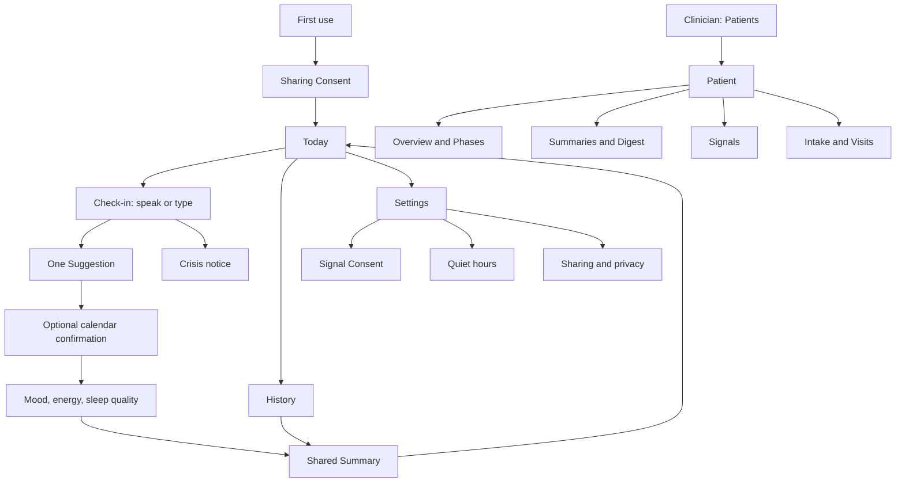

# Depressify interface design

Design date: 13 November 2026. Direction: **Small Step**, selected by the user, refined toward less text, less decoration, and a calm, friendly experience. This is an interface specification and a local interactive design prototype, not a connected clinical product.

## Authority and scope

The merged [system design](../context/system-design.md), [glossary](../../GLOSSARY.md), and current [ADRs](../adr/) define behaviour. ADR 0008 replaces 0004; ADR 0009 replaces 0007. Research informs limitations but does not reopen decisions settled in the merged design. The original ideas document supplies intent; camera capture, music sensing, class booking, embedded maps, peer features, and a clinical treatment product are outside the agreed v1.

The deliverables cover the Patient app, Clinician dashboard, first-use and returning journeys, controls, errors, missing data, accessibility, responsive layouts, and the six-week demonstration. Native permissions, audio, AI, Google Maps, calendar, authentication, Firebase, notifications, email, and deletion are simulated in the prototype. Text typed into the local prototype is never sent to an AI service. Reload resets in-memory prototype changes.

## Intent

**One small thing, between Visits.** For the Patient, the next action stays small enough for a low-energy day. For the Clinician, the next follow-up is understandable without reading a conversation.

The defining objects are a roughly three-minute Check-in, one Suggestion, an Outcome at the next Check-in, one shared Summary, the Patient's own Baseline, and Phases between Visits. These objects give the product its identity. Nature imagery is atmosphere, never evidence that a specific place exists or is accessible.

### Approaches considered

| Direction | Strength | Trade-off |
| --- | --- | --- |
| Quiet Day | Gentle daylight with nature above the action | Photograph pushes the task down |
| Open Conversation | An intimate voice-first threshold | A large microphone and dark field dominate |
| Small Step — selected | The Check-in comes first; one Suggestion supports it | Needs restraint so the Suggestion does not become a second hero |

The user selected Small Step and requested less crowded text, then explicitly added Impeccable and imagegen-frontend-mobile for a gentle illustrative experience and production-quality UI. The refinement removes the duplicate Settings button, full date, orange decorative stroke, extra links, large selected-navigation pill, and repeated explanations. A short sentence replaces motivational paragraphs. Supporting detail appears on demand. A quiet open-window gouache illustration supports first use and empty History; task screens remain plain. Neither imagery nor copy implies a cure or requires the Patient to feel positive.

## Information architecture

Patient navigation has three persistent destinations: **Today, History, Settings**. A Check-in is a dedicated task, not a fourth tab. The tab bar disappears inside focused flows. Back returns to the originating screen; closing a Summary returns to its list. Support is reachable through Settings and the Check-in overflow; a Crisis notice is not placed permanently on Home.

Clinician navigation starts with **Patients**. Patient detail has four sections: Overview, Summaries, Signals, Intake & Visits. Secondary content is disclosed inside these sections rather than adding a broad navigation tree. Prototype scenario controls are outside normal product navigation.

## Visual system

| Role | Decision |
| --- | --- |
| Ground | Paper white `#FAFAF7` |
| Surface | White `#FFFFFF` |
| Quiet surface | Cool gray `#E9EDF0`; pale blue-gray Suggestion background |
| Ink and primary action | Deep blue-green `#233C4C` |
| Secondary text | `#59656B`, checked against its actual surface |
| Borders | `#D7DDE0`, only for forms and useful separation |
| Attention | Green, amber, red only on clinician status; always paired with words and reasons |
| Type | System sans; platform-native fallback; tabular figures on compared data |
| Scale | Today headline 44/46 px; other Patient headlines 32/35 px; section 22/28; body 16/24; supporting 14/20. Clinician title 24/30; body 14–16; chart ticks at least 12 |
| Space | 4, 8, 12, 16, 24, 32, 48; 24 px Patient margins, 16 on narrow screens |
| Shape | Pill primary buttons; 16 px supporting surfaces; 10 px inputs; no mixed decorative radii |
| Depth | Flat resting surfaces. Elevation reserved for a menu, sheet, or dialog |
| Imagery | An illustrated map of nearby places on Today; one Finnish autumn landscape on the Suggestion detail; optional elsewhere only when it clarifies a Suggestion |

No glass, gradients (the voice orb is the one exception), animated backgrounds, confetti, mood emoji, completion rings, streaks, achievement scores, or alarming Patient status colors. Icons support meaning and retain text labels; use an existing icon set (Phosphor). A round icon tile is allowed where the icon names a Signal, a rating or a kind of Suggestion and sits beside its label. The `Depressify` wordmark is text, not an invented medical symbol. Do not expose domain capitalization mechanically in long prose.

### Night theme

From 22:00 to 05:00 the Patient app switches to a dark palette (ground `#101B21`, ink `#E4EBE8`, secondary `#9FB1B5`), and Today changes its words to `Nights can feel long.` / `I’m here if you want company.` / `Talk for a bit`. Sheets stay light. Photos dim slightly. The time-of-day greeting sits on one quiet line above the headline: `Good morning, Alex`. The date sits on the Check-in card.

Design Taste's editorial-greeting composition was dealt with seed **1605424581**, preserving the selected palette and type. Its open-plane shell and tonal grouping inform the desktop. The brief overrides its generic four-count home pattern: this product has no useful KPI row. The clinician list leads with people and reasons. A changing Patient rating is data, not a performance target.

### Health-style cards

Added on 2026-11-14 after review comments on Today, History, Signals and Summary. The Patient asked for less text, visible progress, places to go and a journal of Check-ins, with Apple Health and Samsung Health as references. Three Today layouts were prototyped (ring first, Check-in first, path); **Check-in first** was chosen. The prototype with all three is kept on the branch `codex/prototype-today-variants`.

What the references contribute: one soft card per subject, an icon tile beside each label, one large tabular value, and a small chart or scale instead of a sentence. Apple Health pairs State of Mind entries with factors such as sleep and exercise; Samsung Health leads with a compact activity summary and stacks rounded cards below it.

| Surface | Pattern |
| --- | --- |
| Check-in card (Today) | Date and `About 3 min · AI Companion` on one line, a still orb, the title, and two actions with icons: **Talk** and **Type** |
| Week row (Today, History) | Seven short bars, one per day. A bar fills once a Check-in exists for that day; today is tinted; other days stay neutral |
| Places card (Today) | A map with three pins: Park, Yoga, Meditation. Chips choose the kind; one row names the place, the walking time and a link to Google Maps; the last row opens the current Suggestion |
| Trend card (History) | Mood, Energy and Sleep quality behind one segmented control; unanswered days are gaps |
| Your path (History) | Check-ins as steps on one line, newest first, each with its Suggestion icon, date, title, mood dots and `Tried` when the step was tried |
| Signal groups (Signals) | Body, Places, Your day, Check-ins. Each row has an icon tile, the latest value or `Not collected`, and an On or Off pill |
| How you felt (Summary) | Three ratings with icon, value and a five-dot scale; then the next small step and the previous Outcome as plain rows |

Progress rules. Studies of people with depression report that streaks and achievement rewards feel goal-driven and that a lost streak leads some people to disengage ([Frontiers in Digital Health 2022](https://www.frontiersin.org/journals/digital-health/articles/10.3389/fdgth.2022.1045765/full), [JMIR mHealth 2025](https://mhealth.jmir.org/2025/1/e67141), [JMIR mHealth 2026](https://mhealth.jmir.org/2026/1/e95414)). So the week row only counts what happened: no goal, no streak, no reset, no percentage, and a day without a Check-in is never marked as missed.

Places rules. With a Patient signed in, Today's Suggestion draws its places as icon pins on a calm Google map (Maps SDK for Android and iOS: shops and transit hidden, parks kept), with the Patient's area as a blue dot. One row under the map names the chosen place, how far it is in a straight line, and links to Google Maps; the link's words carry the source. Without a Maps key the same rows list every place. The demo Today keeps the illustrated map, labelled `Demo places`. Links open Google Maps outside the app.

## Patient screens and states

| Screen | Default content and action | Other required states |
| --- | --- | --- |
| Welcome | `A little support, at home.` One sentence identifying the AI Companion. Continue; `Explore the demo` is secondary | Anonymous startup loading, failed startup and Retry; no account creation or Invite requirement in demo |
| Sharing Consent | Name the linked Clinician; show exactly what is shared. A short sample Summary. Explicit choice to share, with a usable decline path | Not yet chosen, accepted, declined, save failed; do not bundle with Signal Consent |
| Today | `One small thing is enough.` / `A few minutes, at your pace.` Check-in card with Talk and Type; week row; places card that opens the latest Suggestion | First use has no empty card; after Check-in shows latest Suggestion; offline exposes saved content and a reconnect action; stale data is labeled |
| Check-in introduction | First use: `I'm an AI Companion, not a clinician.` Explain audio streaming, temporary transcript, saved Summary, and source notice. Start speaking or type | Microphone not requested until speaking; denied or unavailable offers Type instead; simulated permission is clearly a prototype state |
| Live Check-in | Calm status Listening / Companion speaking / Microphone off. Persistent verbatim transcript and obvious mute, type, finish controls | Connecting, long pause, interruption, muted, typing, looking up context, failed tool, disconnected, approaching time cap; never imply recording before connection |
| Typed Check-in | Same conversation and tools; text field and Send; spoken output can be muted | Empty send disabled; multiline input; keyboard moves composer, not transcript; draft survives a tool failure, not an app crash |
| Previous Outcome | `Did you try the walk?` Tried / Not this time / Prefer not to say; when tried, optional 1–5 feeling | No previous Suggestion skips this; no inferred failure from missing answer; no moralized adherence copy |
| Suggestion | One concrete activity and why it fits, at most one short sentence. `That works` / `Something smaller` / `Not now` | Place absent, route lookup failed, calendar unavailable, alternative simpler activity, already accepted; no activity catalogue |
| Place detail | Place name, walking time if known, Google Maps source immediately beside result, Open in Google Maps | No embedded map; missing duration omitted; external return preserves Check-in; walking caveat only when a walking route is supplied |
| Calendar confirmation | Activity, date, local time, duration, destination calendar, explicit Add action. Spoken agreement can authorize the same operation | Read Consent separate from booking authorization; access declined; busy slot; save failed retains fields; added status only after success; repeated tap must not duplicate |
| Ratings | Mood, energy, sleep quality, each 1–5, one question at a time. Endpoints written out; Skip is visible | Unanswered remains null; never preselect 3, infer a self-report, or substitute a questionnaire; back preserves earlier choices |
| Finishing | `Making your Summary…` End microphone and playback immediately; no spinning full-screen trap | Pending, save failed with retry while transcript is still in memory, saved; closing warns the Summary cannot be recovered if it is not saved |
| Summary | Themes, a How you felt card with three ratings, the next small step, the previous Outcome, Voice cues under an optional disclosure. Label AI-generated, and shared status | Patient and Clinician receive the same Summary; no full transcript or audio playback; empty/short Check-in says there was little to summarize; failed generation never invents success |
| History | Week row, a trend card for mood, energy and sleep quality, and Check-ins as a path, newest first | First Check-in CTA, missing ratings as gaps, date group empty, loading, stale cached list, read failure; a lone rating is one point, not a fabricated trend |
| Settings | Signals, Quiet hours, Sharing & privacy, Support; compact rows | Saved state, save error, offline; no account/password settings invented for anonymous demo |
| Signals | Grouped cards; each Signal has its own Consent row with icon, latest value or status, and an On or Off pill | Off, requesting, on, no data, unsupported, stale, permission lost, stopping and deleting, deletion failed |
| Signal detail | What is read, what leaves the phone, why it helps; Enable / Stop and delete | Native permission is separate from app Consent. Stopping deletes its collected data; explain effects before confirmation; failure cannot be presented as completed deletion |
| Quiet hours | Start and end local times; overnight range supported; save confirmation | Default proposed 21:00–09:00; invalid or identical endpoints rejected in prototype; save failed preserves edits; time zone shown |
| Sharing & privacy | Linked Clinician and exact sharing scope; current Consent. Explain provider processing without absolute secrecy claims | Withdraw pauses access. Confirmation names affected progress data and deletion; service must reconcile derived records before shipping. No hidden transcript archive |
| Support | AI/nonclinical scope; how help works; no promise of immediate clinician monitoring | The demo's help path is explicitly simulated; no real emergency number invented |
| Crisis notice | `Let's find human support.` Short calm sentence, prominent help options, Keep talking / Return. Available immediately without a network round trip | Offline help remains visible; alert queued is not delivered; dialler requires Patient action; prototype shows a simulated dialler with no callable number |

### Check-in journey

Returning Patient → contextual greeting → previous Outcome → listen → one Suggestion → explicit commitment → optional calendar confirmation → the conversation stays open until the Patient taps Finish → reflection → shared Summary. The Companion never closes the Check-in and asks for no on-screen ratings; a rating appears in the Summary only when the Patient said it. The Patient can type, decline an activity, mute, or finish at any time. The primary action moves with the current task; there are never three competing filled buttons.

Three minutes is an expectation, not a countdown or achievement target. At approximately seven minutes, a quiet message says `About a minute left. Let’s choose one small step.` Finish before the eight-minute cap. No session resumption is offered. A dropped connection may retry as a new connection; already held content can finish into a Summary. The UI must not imply the old session resumes.

In the voice Check-in the live caption is the transcript: the current utterance with its speaker, always on and never hidden behind a captions toggle. `Transcript so far` opens every earlier line. The typed Check-in keeps the full transcript list. Live screen-reader announcements report status changes and completed utterances, not every token. Barge-in stops playback immediately. Silent pauses are allowed; no forced animation or nagging prompt.

### Voice session (Gemini Live)

The voice Check-in has one focal object, an orb, with a one-word state under it and the live caption below. A four-part marker at the top (`Last time`, `Your day`, `One idea`, `Wrap up`) follows the shape of the conversation. The bottom bar holds `Type`, a 72 px microphone toggle and `End`.

| State | Live API event | Orb and copy |
| --- | --- | --- |
| Connecting | Ephemeral token, `setupComplete` | Birch grey, `Connecting` |
| Speaking | Model audio with `outputTranscription` | Sand gradient sized by output level; caption words appear as they stream; `tap to interrupt` |
| Listening | Microphone stream with `inputTranscription` | Teal gradient sized by microphone level; caption under `You` |
| One moment | `toolCall` (weather, places, calendar, health) | Lake blue gradient with a thin arc; the tool is named in plain words |
| Interrupted | `serverContent.interrupted` | Tapping the speaking orb stops playback at once and returns to listening |
| Microphone off | `audioStreamEnd` | Grey orb; `Paused. Tap the microphone to go on, or type.` |
| Connection lost or paused | Socket closed, or app backgrounded | Notice with `Try again` or `Resume`, and `Finish with what we have` |
| Finish | The Patient taps Finish | The reflection screen, which makes the Summary straight away |
| Crisis | Raise-crisis tool | Crisis notice before any network call |

The orb is a WebGL cloud field adapted from the orb-ui `cloud` theme (MIT): warped noise forms a two-tone sky with a light band along a moving horizon. Each state has a four-colour gradient drawn from the Depressify palette, and states crossfade over about half a second. The audio level rises over about 210 ms and falls over about 380 ms; drift speed and size follow the level, running at 75% of orb-ui's tempo to stay calm. Under Reduce Motion, or when WebGL is unavailable, the orb paints a still frame or a flat CSS sphere and only its colour changes. When the Suggestion card arrives, the orb shrinks to 112 px so the card and its main action stay above the controls. What the Companion records is shown plainly under the caption, for example `Noted: walk tried · felt 4 of 5`.

### Suggestions and learning

Walking, music, calling someone, and finding a class use one shared Suggestion anatomy. Music opens an external music app; it does not inspect listening history. A class can open its source but cannot be booked in v1. Calling someone opens a user-controlled dialler, never initiates a call. All external operations have a return path.

An Outcome is the Patient's report, not a sensor verdict. Sensor changes may inform learning but cannot override `Not this time`. The Clinician's `What seems to help` states counts and the observed period, not causal benefit or a ranking of Patients. Experimentation is invisible as machinery; an unfamiliar Suggestion still explains itself in plain language.

### Signal Consent

Expose sleep, steps, heart rate, resting heart rate, HRV, time at home, movement radius, calendar load/free time, weather context, and self-reported ratings/Voice observations in their appropriate controls. Late-night screen time is marked optional/spike-dependent; it is not silently enabled. Data sharing and use of self-reports/Voice observations must be disclosed even though they do not have a separate operating-system grant. No synthetic fallback is silently mixed into a device Patient.

Each row says what it is, its source, and whether data exists. Calendar reading does not grant permission to book. Location raw samples stay on the phone; only aggregates leave it, and relevant location may be used to fulfill requested place/weather lookup. Precise location is not exposed on the Clinician dashboard. Baseline is the prior 14 days with at least five valid days; until then say `Building your Baseline` rather than show a target. Health access being granted never guarantees the watch wrote data. A device Patient without HRV shows missing HRV; never add seeded HRV to device Signals. A wholly synthetic demo is a separate source.

### Edge decisions made for this design

These are explicit design proposals filling gaps in the source, not claims that the backend already implements them.

- Sharing declined: Check-ins continue privately. Clinician reads, attention monitoring and queued clinician notifications stop for that Patient. Withdrawal immediately hides linked progress, revokes access and deletes shared progress under the final derived-data policy. Re-consent enables future sharing only; it does not restore deleted records. The two standalone prototypes do not synchronize this change with each other.
- Self-reported ratings and Voice observations have individual Consent rows. Turning ratings off skips their collection and rating charts; turning Voice observations off omits those observations. A transient safety judgment of volunteered conversation content requires its own first-use disclosure even when ratings/observations are off. Declining all AI processing prevents a Check-in but leaves saved History and human Support accessible.
- A Crisis notice can interrupt Check-in, finishing, Summary or Today whenever the current Check-in's server result arrives. If the app is backgrounded, a generic notification invites the Patient back to help; no sensitive lock-screen text or automatic call. Keep talking starts a new user-initiated Check-in if the original ended or reached its cap; it never pretends to resume audio.
- An uncleared red flag cannot be downgraded by amber/green results. Add reasons to its history and retain the highest active level until clinician clearance. An ordinary assessment timeout shows `Assessment pending/unavailable` beside the last known flag, never fabricated green. Retry does not clear existing reasons. Concurrent reasons raised after a clearance dialog opens require a new review.
- Leaving the app stops microphone/playback immediately. Preserve in-memory text and the chosen Suggestion; foreground return shows Interrupted, with a new connection or Finish choice. The original wall-clock cap still applies. Incoming calls and screen lock follow this rule; a crashed process loses temporary text as documented.
- Finish retry uses the same Check-in identity. First reconcile uncertain success; do not create a second Summary, Outcome, booking or red email. If the Suggestion/calendar event saved before Summary failure, show that saved result independently. The prototype's booked state demonstrates that distinction locally.
- Each Check-in keeps at most one current accepted Suggestion. Something smaller replaces the unaccepted proposal; Not now records declined. Finishing early records no Suggestion. Unknown Outcome, declined proposal and a Patient saying not tried are distinct. The next Outcome references the most recent accepted, unreviewed Suggestion, not an arbitrary generated card.
- Calendar sensing may stay off while the Patient explicitly authorizes one booking. Show account and writable destination before confirmation. Read-only/partial, expired and cancelled authorization offer Connect for booking or Continue without booking. Do not silently expand scopes or infer that unknown availability means free.
- Nudges need their own notification choice. Denied/revoked access shows Off with a path to native settings, without blocking Check-ins. Do not use stale Signals or unknown calendar availability as evidence of a free weather-compatible slot. The generic evening invitation can remain eligible under daily/quiet-hour limits.
- Settings contains a standing Google Maps notice, with source links also kept in the live transcript/result. Privacy details distinguish app deletion from provider retention, name the research's up-to-55-day abuse retention, mark Live retention unconfirmed, and explain that EU database hosting is not EU-only AI processing. Final production copy must be checked against the chosen provider.
- Phase intervals start at TMS end or a Visit, inclusive, and end immediately before the next Visit. The current Phase is open-ended to today. A backdated Visit recomputes boundaries, never relabels observations by display order. Same-day Visits are separate time-stamped events but one day boundary when timestamps are absent. Missing TMS date shows calendar dates and `TMS end date needed`; pre-TMS observations stay outside Phase comparison. Multiple daily mood ratings stay individual time-stamped observations, or a clearly labeled daily median with sample count.
- Signal measures: sleep duration in hours/minutes (not self-rated sleep quality); steps as daily total; heart rate as labeled daily mean; resting heart rate as reported daily resting measure; HRV source statistic explicitly RMSSD on Android / SDNN on iOS, in ms; time at home in hours; movement radius in km; calendar load as busy minutes/free intervals. Never connect incompatible source/statistic histories or invent a sleep score. Baseline is calculated separately for each measure/source from prior valid daily aggregates.

## Clinician screens and states

| Screen | Default content and action | Other required states |
| --- | --- | --- |
| Sign in | Email and password; Sign in | Invalid credentials without identifying account existence; loading, server error, expired session, sign out; no invented account signup |
| Patients | Sorted red, amber, green; each row identity, attention label/reason, latest Check-in, freshness. Search and attention filter | Empty caseload, no matches, initial loading, read denied, offline stale list, red arrivals; filters never silently hide an urgent banner |
| Red banner | One concise reason and Review Patient; count if multiple | Stays until clinical flag cleared, not until viewed. Optional sound enabled by explicit click; blocked playback leaves visual banner intact |
| Patient Overview | Name, week since TMS, attention reason first, Phase timeline, latest Summary, what seems to help, latest Digest | No history, insufficient comparison, no Visit yet, stale or unavailable data, sharing withdrawn, extraction pending |
| Attention detail/history | Level word and color, observed facts, source, raised time, history, Clear after follow-up | Red crisis, red phone silence, sharp Signal break, amber drift, assessment unavailable, cleared; no probability or risk score |
| Clear attention dialog | `Clear after follow-up` with Patient identity and explanation that history stays. Optional note proposed as workflow context | Cancel, saving, error preserves dialog, success with actor/time; concurrent new reason requires review and must not be cleared accidentally |
| Phase timeline | Six weeks from TMS end, Visit at week three, current week six, earlier/current Phase labels | Mood on 1–5 scale; PHQ-2 and PHQ-9 on their own labeled scales aligned in time; gaps remain gaps; questionnaire type changes are not one connected line |
| Signals | Trends against own Baseline; value, unit, date window, valid days, source/freshness | No Consent, no source data, unsupported, permission revoked, insufficient Baseline, stale, device/synthetic label, missing days; never zero-fill |
| Summaries | Newest first, selected Summary reads same content as Patient | Loading, empty, stale, generation failure, insufficient content. Voice cues are observations; flag-supporting quotes only, no raw transcript |
| Weekly Digest | Covered dates, generated time, concise synthesis and source count; Generate now | Missing, generating, failed/retry, stale, regenerated; generating twice is prevented; does not invent days or fill missing Check-ins |
| What seems to help | Suggestion kind, attempts and reported feeling in a stated window | No Outcomes, very few Outcomes, not tried, unknown. No effectiveness percentage without valid evidence |
| Intake & Visits | TMS end date, reviewed Intake highlights, Visits and optional Questionnaire scores | No Intake, extracting, extraction failed, preview/edit/save, no Visits, save failed; no Companion steering prompt |
| Record Visit | Date plus optional PHQ-2 or PHQ-9 type and score; Save Visit | Future date invalid; type-specific integer range 0–6 / 0–27; no score valid; failure retains edits; success updates timeline and Phase boundary |
| Intake entry | Fictional report text/file in prototype; Extract highlights, review, save | Unsupported/empty input, extraction error, unsaved changes, save error; no automatic treatment advice. Real file handling requires production constraints |
| Access/session | No sensitive content when unauthorized; return to sign-in | Failed refresh cannot leave another Patient's record visible; withdrawn sharing hides content, even if a tab was open |

### Attention is a work queue, not a diagnosis

Red means review first; amber means drift worth a look; green means no current attention reason, not `safe` or `recovered`. Reasons say `Phone has not connected for 24 hours` or `Sleep fell sharply compared with the Patient's Baseline`. They never infer self-harm from silence. Signals alone do not show a Crisis notice on the phone. A safety-filter refusal says `Could not be assessed automatically` and raises amber.

Questionnaire scores remain descriptive records of Visits and never feed the Attention flag. Clearing a flag records the Clinician's action and preserves history. Refresh, sorting, or opening a record cannot clear one. Email pending/failed/delivered are different states; the local prototype only simulates them. Follow-up itself occurs outside this dashboard; no messaging workflow is invented.

### Phase timeline

Use one shared date domain with visibly separate lanes for Patient mood and Clinician-entered Questionnaire scores. Shade or bracket the two Phases without implying causality. Mark the actual TMS end and each Visit, with readable dates. Select a Phase to inspect its underlying observations; show valid sample counts and avoid claiming improvement where a Phase has insufficient data. The six-week demo begins 2 October 2026, with a Visit on 23 October, and ends 13 November. No real patient is represented.

## Interaction contract

| Component | Behaviour |
| --- | --- |
| Buttons | Immediate pointer-down feedback; commit on release; subtle 0.98 press scale only for pointer input. Label states the action. Pending label names work; prevent duplicate submit |
| Navigation | No artificial wait. Keyboard navigation is instant; focus moves to the destination heading and Back restores the trigger |
| Sheets | Mobile runtime spring, approximately 0.3 s critically damped; drag follows finger, velocity-aware release, interruption allowed; button alternative always present |
| Dialogs | Focus contained; descriptive heading; Escape/cancel; close restores trigger. Confirm only for irreversible deletion/withdrawal or meaningful unsaved loss |
| Forms | Visible labels, contextual native picker, inline error and field association, preserve input on error, focus first invalid field after submit |
| Switches | Label and checked state accessible; async failures restore actual state and explain why; off never claims deletion succeeded early |
| Feedback | Saved status near the affected content. Toast reserved for a cross-screen completion; no safety- or deletion-critical information only in a timed toast |
| Charts | Units, labeled scales and date range; no invented smoothing; gaps for missing data; keyboard-readable data table alongside or under a disclosure |
| Notifications | Generic lock-screen copy: `A moment for you?` / `Your Check-in is here when you want it.` No health reasons or clinical labels on lock screen |

Nudges are at most once daily, outside quiet hours and busy calendar intervals. They never open the microphone or start speech. Tap opens a ready-to-start Check-in; dismissal creates no failure. Approximate background timing is not shown as an exact appointment. Demo controls can trigger a Nudge and next-day Outcome without rewriting the visible date inconsistently.

## Accessibility and adaptation

Patient controls have at least 48×48 px touch areas; desktop controls remain usable by touch at narrow widths. Text scales to 200% without clipping primary actions. Color is never the only status cue. Focus rings are clearly visible on every surface. Respect reduced motion, reduced transparency, and increased contrast independently. Do not autoplay ambient audio. No flashing, forced rhythmic breathing, or full-screen moving nature background.

At 390 px, Patient layout is a single column; the keyboard shrinks transcript space and the composer stays above it. Fixed tabs have safe-area clearance and do not cover the last item. At 768 px, clinician navigation folds and sections stack without hiding reasons. At 1440 px, the clinician canvas has a quiet sidebar and aligned two-column regions with no stretched empty cards. At narrow widths the Patient list becomes labeled rows, not an unreadable horizontally scrolling table. Long names wrap; truncated secondary evidence opens in detail.

The native-app concept follows platform back behavior, OS permission sheets and pickers. The supplied prototype preserves Product Design's calibrated iPhone/Pixel frame, keyboard, scroll and sheet infrastructure. It illustrates the Android-first KMP app without pretending a browser is the production mobile implementation.

## Demonstration and state coverage

Four fictional records: Aino Laine (steadily well), Elias Niemi (declining/sharp sleep change), Mira Koski (sparse Check-ins), Alex Salmi (phone demonstration). Everything in the design prototype is synthetic, including the phone record; a production demo can label actual device aggregates separately. Dates are anchored to Friday 13 November 2026, Europe/Helsinki. Simulating a later day must advance all relevant dates together.

The reviewer can switch prototype scenarios without polluting normal app copy: first use, no history, offline, connection failure, Summary failure, no Signal data, unsupported health access, insufficient Baseline, Consent withdrawn/deletion failure, calendar failure, Nudge, and Crisis. Clinician scenarios include no Patients, no matches, initial loading, stale/offline, expired/denied access, missing data, unavailable assessment, save/generation failure, and silence red. Scenarios are illustrative front-end states, not backend guarantees.

### Coverage checklist

- Patient: first use → sharing choice → Today → voice or typed Check-in → Outcome → Suggestion → optional booking → Finish → reflection → Summary → History.
- Patient: per-Signal Consent → enable/deny/no data → Stop and delete → failed deletion/retry; quiet hours; sharing withdrawal; Help.
- Patient: interrupted/disconnected/short Check-in, unsaved Summary, offline Crisis, user-controlled simulated dialler, notification entry.
- Clinician: sign-in → attention-sorted Patients → Patient Overview → Phase evidence → Summary/Digest → Signals → Intake/Visit → clear attention after follow-up.
- Clinician: red arrival/silence, missing data and Baseline, withdrawn sharing, invalid questionnaire, failed generation/save, expired session.
- Common: hover, press, keyboard focus, disabled, pending, empty, stale, success, error, large text, narrow width, reduced motion.

## Reference comparison

Two Claude Design artifacts (patient flow and clinician dashboard) were reviewed locally against this design; the captures are not kept in the repository. Adopted: the voice orb with live caption and step marker, the time-of-day greeting with a night theme, and the 14-day sleep sparkline with hatched missing days in the clinician list and Signal charts. Not adopted, because the requirements differ: a captions toggle that can hide the transcript, `Crisis` and `No data` as extra flag levels, BDI and HAM-D scores, `Export report` and `Log a call`, voice-feature charts (an on-phone stretch goal), microphone permission during onboarding, and asking `Did the walk help?` on Today (the Outcome belongs to the next Check-in).

## Production handoff and unresolved decisions

The prototype demonstrates navigation and state transitions; the documents remain the contract for backend integration. Consent withdrawal requires a precise deletion policy for derived Summaries, Digests, Baselines and already-issued clinician exports. The sources say collected Signal data is deleted, but do not settle every derived-data case; do not silently invent a retained medical archive. Confirm the policy before connecting real data.

Other remaining decisions are the actual linked Clinician identity, approved Consent wording, mock Crisis number (prototype deliberately uses no dialable number), production support coverage, provider/legal suitability, exact permission scope, Firebase region, and spike results for HRV/iOS/background health. These affect launch, not this local design exercise. The generic landscape is generated atmospheric imagery, not a Maps result. No prototype action sends a real email, books a calendar event, records audio, dials a number, or removes remote records.

Validation must cover the core journeys, numeric constraints, missing-data handling, keyboard/modal focus, responsive screenshots and visual comparison with the selected refined direction. Human usability testing with people after TMS and clinicians, native hardware/audio testing, and a clinical safety review remain separate work; do not claim the prototype provides those assurances.
